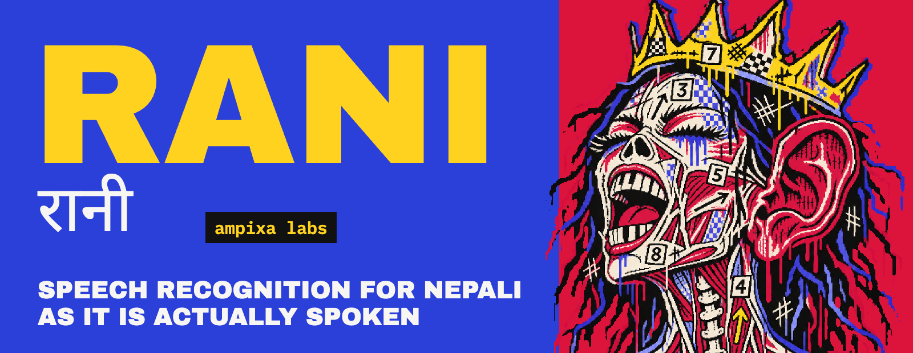
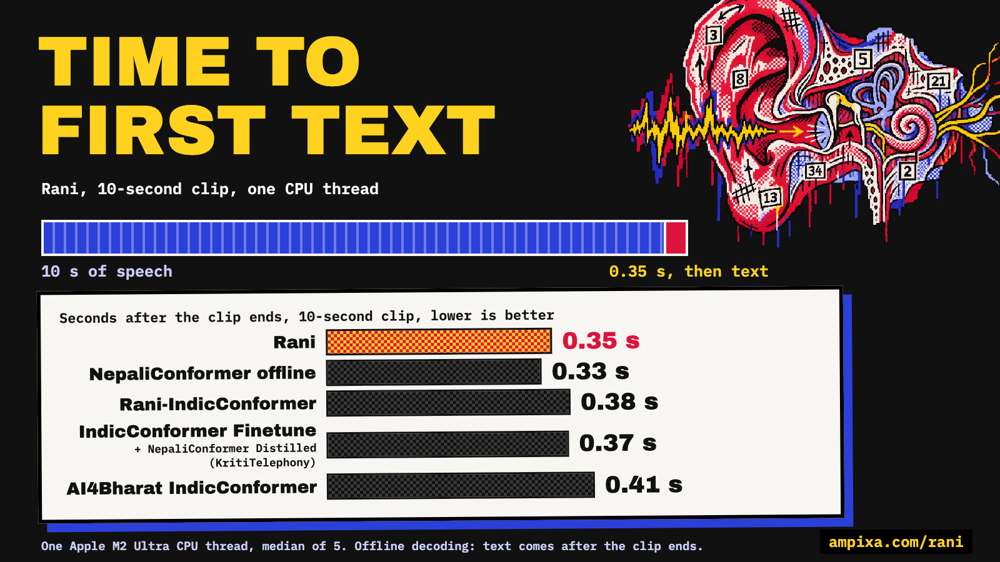

<p align="center">
  
</p>

# Rani (formerly NepaliConformer)

**Speech recognition for Nepali as it is actually spoken.**

Roughly 33 million people speak Nepali, but speech technology for it has been built and measured
almost entirely on read-aloud recordings. Real Nepali — conversation, spontaneous speech, noisy
rooms, code-switching, and yes, phone lines — is a different language acoustically, and the
systems that top read-speech benchmarks fall apart on it. Rani is trained mostly on
*conversational* Nepali and evaluated on the hardest real-world condition we could obtain
references for. Conformer as the backbone, Nepali at heart: we're bridging that gap
in the open.

**Page:** [ampixa.com/rani](https://ampixa.com/rani/) · **Weights:** [ampixa/rani-asr](https://huggingface.co/ampixa/rani-asr) (approval required) · **Demo:** [HF Space](https://huggingface.co/spaces/voidash/rani-asr)

Released as a **research prototype** with a public real-speech benchmark (**NepTel**) and
per-system outputs so every number can be re-derived.

## NepTel 0.2: how everything compares

NepTel is our benchmark of **real Nepali phone audio**: 78 segments, 2,647 words, 31.5 minutes, 8 kHz.
56 segments are customer-support calls from the [InfoBay public samples](https://huggingface.co/datasets/InfoBayAI/Nepali_Call_Center_Audio_Dataset_Dual_Channel);
22 are new calls with our voice assistant (the speaker is the author).

**How the references were made.** In 0.2 **every reference has been listened to and corrected by a
human**, against the audio. Drafts came from an automatic transcriber, so that transcriber is not a
ranked entrant on this set.

| system | mistakes per 100 words ↓ | gap to Rani (95% CI) |
|---|---|---|
| **Rani** (no language model) | **33.5** | |
| IndicConformer Finetune + NepaliConformer Distilled ([KritiTelephony](https://github.com/Naamche-Labs/kriti-telephony)) | 37.9 | +4.4 (+1.9, +6.9) |
| NepaliConformer offline (our previous model) | 39.7 | +6.2 (+3.2, +9.0) |
| IndicConformer Nepali (AI4Bharat) | 47.6 | +14.1 (+10.4, +18.0) |

Every number re-derives from `benchmark/outputs/` with `eval/score_v02.py`. English spelled in either script counts as the
same word, so bilingual models are not penalised for their alphabet.

v0.1 files are kept as `benchmark/references_v0.1.json` and `benchmark/outputs_v0.1/`; the v0.1 history is in [RESULTS.md](RESULTS.md#neptel-v01-historical).

## Clean speech

| test | Rani (language model) | IndicConformer Finetune + NepaliConformer Distilled ([KritiTelephony](https://github.com/Naamche-Labs/kriti-telephony)) | IndicConformer |
|---|---|---|---|
| PVSpeech, 93 clean read sentences (mistakes per 100 letters) | **3.6** | 3.8 | 9.8 |
| FLEURS Nepali test, 726 sentences (mistakes per 100 letters) | 10.4 | 9.9 | **7.4** |

On PVSpeech the gap is within noise, and that set also helped select Rani's checkpoint. PVSpeech is not public yet. The language model is not part of the released weights.

## Speed



Greedy transducer decoding on one CPU thread of an Apple M2 Ultra, batch size 1.

| model | × real time | first text, 10 s clip | first text, 60 s clip | peak memory |
|---|---:|---:|---:|---:|
| **Rani** | **26.8** | **0.35 s** | 3.5 s | 1.9 GB |
| NepaliConformer offline | 27.1 | 0.33 s | 3.5 s | 1.9 GB |
| AI4Bharat IndicConformer | 21.1 | 0.41 s | 4.3 s | 1.8 GB |
| Rani-IndicConformer | 20.8 | 0.38 s | 4.3 s | 1.8 GB |
| IndicConformer Finetune + NepaliConformer Distilled ([KritiTelephony](https://github.com/Naamche-Labs/kriti-telephony)) | 19.1 | 0.37 s | 4.3 s | 2.0 GB |

× real time is over 25 public NepTel clips, 622.72 s of audio. First text is the median of 5 runs. Rani and NepaliConformer offline ran on NeMo 3.0.0, the others on NeMo 1.23.0rc0, so the gap is not purely the model. The machine was also running other work. Rani decodes offline, so text arrives when the clip ends, not while you speak. With 4 threads Rani reaches 34.5 times real time.

## Models

| class | model | status |
|---|---|---|
| Old model | `nepali-conformer-offline`, `nepali-conformer-streaming` | [ampixa/rani-asr](https://huggingface.co/ampixa/rani-asr), gated with approval; also at [offline](https://huggingface.co/ampixa/nepali-conformer-offline) · [streaming](https://huggingface.co/ampixa/nepali-conformer-streaming) |
| New | **Rani** | [ampixa/rani-asr](https://huggingface.co/ampixa/rani-asr), gated with approval |
| New | **Rani-IndicConformer** (a full IndicConformer fine-tune) | [ampixa/rani-asr](https://huggingface.co/ampixa/rani-asr), gated with approval |

Both are 17-layer, d=512 Conformer encoders (subsampling ×4, 40 ms frames) with hybrid TDT/CTC
decoders and a 1,024-piece SentencePiece vocabulary. The offline model is trained for full-context
decoding on conversational and telephone speech, with half of its audio passed through a real
AMR-NB phone codec; the streaming model adds a wider telephony and noise mix. The
streaming model uses chunked-limited attention (`[[70,13],[70,6],[70,1],[70,0]]`) with fully
causal convolutions and runs in a cache-aware incremental loop.

## What Rani brings compared with IndicConformer

| | IndicConformer Nepali (AI4Bharat) | Rani |
|---|---|---|
| Contribution | the multilingual Indic base model | own TDT/CTC heads and a 1,024-piece Nepali vocabulary on the same encoder; trained on conversation and calls |
| Decoder | RNNT + CTC | **TDT** (a transducer that also predicts token durations) + CTC |
| Vocabulary | shared multilingual, 5,632 pieces | **Nepali-only**, 1,024 pieces |
| Training focus | multilingual Indic model | **conversational Nepali and real phone calls** |
| NepTel 0.2 (mistakes per 100 words) | 47.6 | **33.5** |
| Private customer-service calls, 127 calls never seen in training (not publicly checkable) | 38.9 | **30.6** |
| PVSpeech (mistakes per 100 letters, with language model) | 9.8 | **3.6** |
| FLEURS Nepali (mistakes per 100 letters, with language model) | **7.4** | 10.4 |

## Benchmark your own system

The audio is public and ungated at
[`ampixa/neptel`](https://huggingface.co/datasets/ampixa/neptel) — no login, no access request:

```bash
cd benchmark && python fetch_audio.py neptel_audio
python ../eval/score_v02.py --hyp your_outputs.json
```

We would love to be beaten — open a PR with your outputs.

## Download & run

**Get the weights.** Request access at [ampixa/rani-asr](https://huggingface.co/ampixa/rani-asr), then:

```bash
pip install -U huggingface_hub "nemo_toolkit[asr]"
hf download ampixa/rani-asr --local-dir rani-asr
```

**Transcribe** with Rani:

```python
import nemo.collections.asr as nemo_asr
from omegaconf import OmegaConf, open_dict

model = nemo_asr.models.EncDecHybridRNNTCTCBPEModel.restore_from("rani-asr/rani/rani.nemo", map_location="cpu", strict=False).eval()
with open_dict(model.cfg):
    model.cfg.validation_ds = OmegaConf.create({"use_start_end_token": False})
model.change_decoding_strategy(model.cfg.decoding, decoder_type="rnnt")
print(model.transcribe(["audio_16k.wav"])[0].text)
```

For Rani-IndicConformer use `nemo_asr.models.ASRModel.restore_from` and pass `language_id="ne"` to `transcribe`. It loads on the NeMo 1.23.0rc0 build used for IndicConformer and does not load on NeMo 3.0.0.

**Streaming demo** (WebSocket server + browser client):

```bash
python streaming/hybrid_stream_server.py --nemo rani-asr/nepali-conformer-streaming/nepali_conformer_streaming.nemo
```

## The one-paragraph honest summary

Rani leads NepTel 0.2 among systems that were not used to draft its references, and is clearly ahead on 127 private customer-service calls it never saw (30.6 mistakes per 100 words, against 38.9 for IndicConformer and 43.0 for IndicConformer Finetune + NepaliConformer Distilled ([KritiTelephony](https://github.com/Naamche-Labs/kriti-telephony))). Those references are machine-made and not publicly checkable.
On clean read Nepali, with a language model, it is level with IndicConformer Finetune + NepaliConformer Distilled ([KritiTelephony](https://github.com/Naamche-Labs/kriti-telephony)) on PVSpeech and close on FLEURS.
Rani's scores above use no language model unless stated.

## NepTel benchmark

`benchmark/` contains the reference transcripts, per-model outputs, the scorer, and a fetch
script for the audio (InfoBay segments published by [InfoBayAI](https://huggingface.co/datasets/InfoBayAI/Nepali_Call_Center_Audio_Dataset_Dual_Channel)
under CC-BY-4.0; our reference transcripts and new recordings are CC-BY-4.0). If you have a Nepali ASR system, we
would genuinely like to see your row: run `eval/score_v02.py` and open a PR.

**Do not train on NepTel.** It is an evaluation set. Canary string for contamination checks:
`NEPTEL-CANARY-2026-8f3a1c92`.

## Layout

```
asr/         transcribe CLI, text normalizer (numbers -> spoken words), telephony simulator
eval/        score_v02.py for NepTel 0.2; score_reference.py for v0.1
streaming/   cache-aware streaming server + browser client
benchmark/   NepTel: references, per-model outputs, fetch script, its own README
RESULTS.md   every measurement, with instruments and caveats
```

## License

Code: MIT. Existing NepaliConformer weights: **CC-BY-NC**. **Rani weights: [LICENSE-MODEL.md](LICENSE-MODEL.md)**: if you
distill Rani, train on its outputs, or build a derivative of it, you must attribute **Ampixa Labs**. NepTel references: CC-BY-4.0
(audio © [InfoBayAI](https://huggingface.co/datasets/InfoBayAI/Nepali_Call_Center_Audio_Dataset_Dual_Channel), CC-BY-4.0).

## Citation

If you use the models or the benchmark, cite this repository. A technical report is in
preparation; the full experimental record (immutable one-JSON-per-run results store) backs every
number here.
